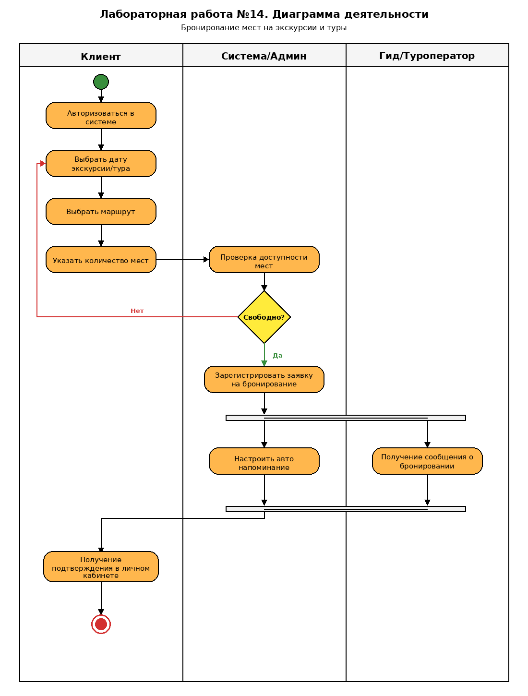

# Лабораторная работа №14

## Диаграмма деятельности (Activity Diagram)

**Тема:** Бронирование мест на экскурсии и туры: даты, маршруты, количество мест

---

### Цель

Построить UML-диаграмму деятельности процесса бронирования мест на экскурсию/тур с дорожками участников, проверкой доступности и параллельными действиями.

### Участники (дорожки)

| Участник | Роль |
|---|---|
| **Клиент** | Авторизация, выбор даты, маршрута и количества мест, получение подтверждения |
| **Система/Админ** | Проверка доступности, регистрация заявки, автонапоминание |
| **Гид/Туроператор** | Получение сообщения о бронировании |

### Ход процесса

1. Клиент авторизуется в системе.
2. Выбирает **дату** экскурсии/тура.
3. Выбирает **маршрут**.
4. Указывает **количество мест**.
5. Система проверяет доступность мест.
6. Решение **«Свободно?»**:
   - **Нет** → возврат к выбору даты;
   - **Да** → регистрация заявки на бронирование.
7. Параллельно:
   - система настраивает автонапоминание;
   - гид/туроператор получает сообщение о бронировании.
8. Клиент получает подтверждение в личном кабинете.
9. Конец процесса.

### Файлы

- `diagramma_deyatelnosti.png` — готовая диаграмма для отчёта
- `Lab14_Bronirovanie_ekskursiy.docx` — отчёт Word
- `diagram.puml` — исходник PlantUML
- `lab14-activity-diagram-tours.png` — альтернативный вариант диаграммы

### Рисунок

